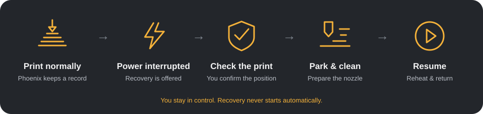

<p align="center"></p>
<h1 align="center">Phoenix for Klipper</h1>
<p align="center"><strong>Give your print a second chance.</strong></p>

Phoenix helps you continue an interrupted Klipper print after a power cut or restart. It saves progress while you print, then guides you through checking the part, preparing the nozzle and returning to a saved point. No UPS or extra hardware required.

Use the guided recovery screens in [Voyager](https://github.com/ozancs/voyager-ui), or follow the prompts in Mainsail and Fluidd. After a one-time setup, Phoenix records automatically. You decide whether an interrupted print is worth recovering—and when to continue.



Recovery gives you time to check that the part is still attached and the axes have not moved, then clean and prime the nozzle at your chosen park point. Phoenix reheats and returns when you confirm. It never homes Z during recovery and never starts moving or heating just because the printer has restarted.

Want to see the flow first? Run **PHOENIX_DEMO** on an empty bed. It moves through a practice recovery without heating or extruding, using the part fan to signal the simulated warm-up. [Try the demo →](docs/DEMO.md)

Phoenix is **experimental**. It cannot measure the exact stopping position: queued moves, Z-hop and movement while unpowered can affect alignment. Recovery may leave a seam or fail, so start with a small supervised test. Currently for single-extruder Cartesian and CoreXY printers; [check compatibility before installing](docs/COMPATIBILITY.md).

## Get started

SSH into your printer while it is idle, then run:

```sh
cd ~
git clone https://github.com/ozancs/phoenix.git phoenix-for-klipper
cd ~/phoenix-for-klipper
bash scripts/install.sh
```

The installer previews its changes, backs up your configuration and connects the print hooks and updater. After reconnecting, open **PHOENIX_SETUP_GUIDE** to choose your park point. Then print normally.

[Setup & updates](docs/SETUP.md) · [Recovery guide](docs/RECOVERY.md) · [Release notes](CHANGELOG.md)

<sub>Licensed under <a href="LICENSE">GPL-3.0-or-later</a>.</sub>
